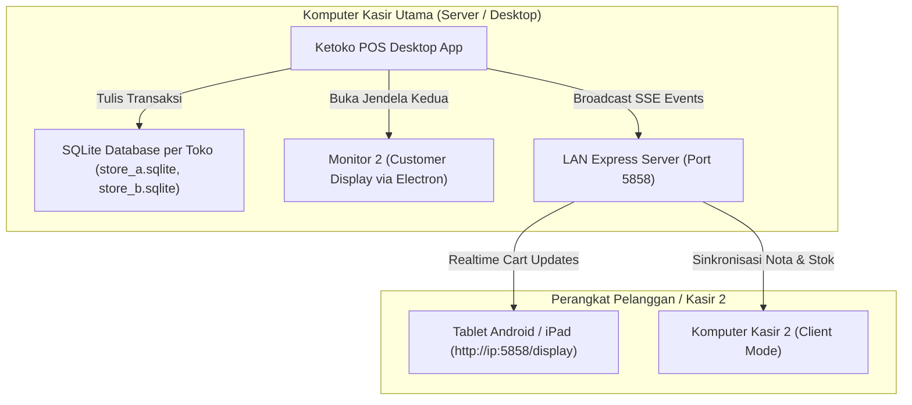

# UI/UX Specification for Stitch: Ketoko POS Modern Features

> **Target Platform**: Desktop POS (Electron) & Web Tablet / Dual-Monitor (16:9 Landscape & 10" Tablet)  
> **Design Theme**: Modern Warm Coffee, Cream, & Earth Luxury Minimalism (Ketoko POS Signature Aesthetic)  
> **Brand Tone**: Warm, trustworthy, fast, modern retail ERP

---

## 🎨 Global Design System & Tokens

```yaml
Color Palette:
  Primary Brand: "#7C4E2F" # Warm Roast Coffee
  Primary Hover: "#673E24"
  Primary Light: "#F5ECE3" # Warm Foam Latte
  Primary Surface: "#FBF7F4" # Soft Cream Background
  Accent Amber: "#D97706" # Warning / Pending / Promo Highlights
  Accent Emerald: "#059669" # Success / Paid / Active Status
  Accent Blue: "#2563EB" # Secondary info / Cloud indicators
  Text Main: "#332219" # Deep Espresso
  Text Muted: "#856B59" # Coffee Husk Grey
  Border Subtle: "#E4D5C7" # Warm Sand Border
  Card Background: "#FFFFFF"
  Dark Mode / Contrast Card: "#1C1512"

Typography:
  Heading Font: "Plus Jakarta Sans, Inter, sans-serif"
  Numbers / Currency Font: "JetBrains Mono, Roboto Mono, monospace" (tabular figures for prices)

Geometry & Elevation:
  Border Radius: "rounded-2xl (16px) for cards, rounded-xl (12px) for buttons, rounded-full for badges"
  Shadows: "shadow-sm border border-[#E4D5C7] for clean card separation"
```

---

# Screen 1: Multi-Store Gateway & Login Hub (Halaman Awal Pilihan Toko)

### 📌 Overview & Purpose
Layar pertama yang tampil saat aplikasi dibuka. Pengguna dapat memilih database toko mana yang ingin dimasuki (misal Toko Sembako, Toko Cabang Balikpapan, Toko Elektronik), membuat toko baru, atau berpindah toko tanpa risiko data transaksi atau stok bercampur.

---

### 🖥️ Wireframe & Layout Hierarchy

```
+---------------------------------------------------------------------------------------------------+
|  [Logo Ketoko POS]  Ketoko POS Multi-Database Hub                    [Status Jaringan: LAN Online] |
+---------------------------------------------------------------------------------------------------+
|                                                                                                   |
|                                     PILIH DATABASE TOKO                                           |
|               Pilih cabang toko yang ingin dibuka atau kelola database toko baru                  |
|                                                                                                   |
|  +---------------------------+  +---------------------------+  +-------------------------------+  |
|  | 🏪 Toko Utama (Sembako)   |  | 🏪 Cabang Balikpapan      |  | ➕ Buat Database Toko Baru    |  |
|  |                           |  |                           |  |                               |  |
|  | Cabang: BR-01             |  | Cabang: BR-02             |  | Siapkan toko / cabang baru    |  |
|  | Database: SQLite Lokal    |  | Database: SQLite Lokal    |  | dengan katalog produk bersih  |  |
|  | Kasir Aktif: 2 Terminal   |  | Kasir Aktif: 1 Terminal   |  |                               |  |
|  | Total SKU: 24.531 Barang  |  | Total SKU: 3.200 Barang   |  |                               |  |
|  | Status: [● Aktif Lokal]   |  | Status: [● Aktif Lokal]   |  |                               |  |
|  |                           |  |                           |  |                               |  |
|  | [ MASUK TOKO INI → ]      |  | [ MASUK TOKO INI → ]      |  | [ + BUAT TOKO BARU ]          |  |
|  +---------------------------+  +---------------------------+  +-------------------------------+  |
|                                                                                                   |
|  +---------------------------------------------------------------------------------------------+  |
|  | ℹ️ Info Multi-Database: Setiap toko memiliki data barang, stok, nota, dan laporan terpisah   |  |
|  +---------------------------------------------------------------------------------------------+  |
|                                                                                                   |
+---------------------------------------------------------------------------------------------------+
|  Ketoko POS v2.1.0 • Multi-Cluster Standalone & LAN Cluster                  [⚙️ Pengaturan Server] |
+---------------------------------------------------------------------------------------------------+
```

---

### 🧩 Components & States

#### 1. Store Card Component
* **Header**: Ikon toko, nama toko (bold 18px), badge cabang (`BR-01`), dan status dot hijau (`● Aktif`).
* **Metadata List**:
  * Jumlah SKU Produk aktif
  * Kasir / user terdaftar
  * Tipe database (`Lokal SQLite` / `Cloud Supabase`)
  * Waktu transaksi terakhir
* **Action**: Tombol utama *"Masuk Toko Ini"* beranimasi hover scale.

#### 2. PIN & Cashier Login Modal (Muncul saat kartu toko diklik)
* **Title**: *"Masuk ke [Nama Toko]"*
* **Cashier Avatar Selector**: Pilihan nama kasir (misal *Suciawati*, *Noor Afifah*, *Admin Toko*).
* **PIN Numpad**: 
  * 4-6 bulatan PIN masking (`••••`).
  * On-screen touch keypad numpad `1` s/d `9`, `0`, tombol `Hapus`, dan `Masuk`.
* **Action**: Tombol *"Buka Mesin Kasir"* (Primary Button).

#### 3. Modal "Buat Database Toko Baru"
* **Form Inputs**:
  * Nama Toko (e.g. *"Toko Berkah Abadi"*)
  * Kode Cabang (e.g. *"BR-03"*)
  * Kategori Usaha (Pilihan: Sembako / Minimarket, Fashion / Pakaian, F&B / Cafe, Elektronik, Apotek)
  * Opsi Salin Katalog: `[ ] Salin daftar harga dari Toko Utama` atau `[ ] Mulai dari katalog bersih kosong`.
* **Action Buttons**: *"Batal"* (Secondary) dan *"Buat Toko & Buka"* (Primary Emerald).

---

# Screen 2: Customer Facing Display (Layar Pelanggan)

### 📌 Overview & Purpose
Layar kedua yang menghadap pembeli (Customer Facing Display). Bisa dibuka di monitor kedua kasir (Dual Monitor HDMI/VGA) atau diakses lewat tablet Android/iPad yang diletakkan di meja kasir via jaringan Wi-Fi lokal toko (`http://<ip-kasir>:5858/display`).

---

### 🖥️ Wireframe & Layout Hierarchy (Screen Split 60/40)

```
+---------------------------------------------------------------------------------------------------+
|  [Logo Toko] TOKO BERKAH JAYA - SAMARINDA                         Senin, 10 Nov 2026 • 11:20 WITA  |
+----------------------------------------------------+----------------------------------------------+
|  DAFTAR BELANJA ANDA                               |  RINGKASAN PEMBAYARAN                        |
|                                                    |                                              |
|  +----------------------------------------------+  |  Total Item Belanja: 3 Barang (5 Pcs)        |
|  | 1. Minyak Goreng Bimoli 2L                   |  |                                              |
|  |    2 Pcs x Rp 38.000             Rp 76.000   |  |  Subtotal:                     Rp 114.000    |
|  +----------------------------------------------+  |  Diskon Promo Member:         -Rp   5.000    |
|  | 2. Gula Pasir Gulaku 1kg                     |  |  Pajak (PPN 0%):                     Rp 0    |
|  |    2 Pcs x Rp 16.500             Rp 33.000   |  |----------------------------------------------|
|  +----------------------------------------------+  |  TOTAL PEMBAYARAN                            |
|  | 3. Kopi Kapal Api Special 165g               |  |  Rp 109.000                                  |
|  |    1 Pcs x Rp 10.000             Rp 10.000   |  |  (Seratus Sembilan Ribu Rupiah)              |
|  +----------------------------------------------+  |                                              |
|                                                    |  +----------------------------------------+  |
|  (Barang terakhir di-scan berkedip halus hijau)    |  |  [QRIS CODE DINAMIS]                   |  |
|                                                    |  |  Scan dengan GoPay, OVO, Dana, BCA     |  |
|                                                    |  |  Nominal: Rp 109.000                   |  |
|                                                    |  +----------------------------------------+  |
|                                                    |                                              |
|                                                    |  Kasir: Suciawati • Terminal: Kasir 01       |
+----------------------------------------------------+----------------------------------------------+
|  📢 PROMO MINGGU INI: Beli 2 Susu UHT Indomilk Gratis 1 Teh Kotak! • Buka Setiap Hari 07.00-22.00  |
+---------------------------------------------------------------------------------------------------+
```

---

### 📱 4 Interactive States Customer Display

#### State 1: STANDBY / IDLE (Saat Belum Ada Transaksi)
* **Visual**: Full-screen elegan dengan background warm latte cream.
* **Elemen**:
  * Logo Toko ukuran besar di tengah.
  * Ucapan *"Selamat Datang di [Nama Toko]"*.
  * Carousel banner promo berjalan (berganti otomatis setiap 5 detik).
  * Jam digital dan tanggal saat ini.
  * Teks footer: *"Kasir Siap Melayani Anda"*.

#### State 2: SCANNING / ACTIVE CART (Saat Kasir Scan Barang)
* **Left Column (60%) - Item Feed**:
  * Tabel belanja beranimasi mulus saat barang baru masuk (Slide-in).
  * Item terakhir yang di-scan diberi highlight warna hijau emerald lembut.
  * Menampilkan: Nama barang, satuan, Qty, harga satuan, dan subtotal item.
* **Right Column (40%) - Total Board**:
  * Tulisan **TOTAL** berukuran besar (font size 48px - 64px, warna `#7C4E2F`).
  * Informasi penghematan: *"Anda Hemat Rp 5.000 hari ini!"* (hijau).
  * Status member pelanggan (misal: *Pelanggan: Bpk. Bambang - Member Gold*).

#### State 3: PAYMENT IN PROGRESS (Saat Kasir Membuka Layar Pembayaran)
* **Jika Metode QRIS**:
  * Tampil QR code QRIS beresolusi tinggi di tengah panel kanan.
  * Panduan: *"Scan menggunakan BCA, Mandiri, Dana, GoPay, OVO, ShopeePay"*.
  * Timer hitung mundur pembayaran.
* **Jika Metode Tunai (Cash)**:
  * Total Tagihan: `Rp 109.000`
  * Uang Diterima: `Rp 150.000`
  * **KEMBALIAN: `Rp 41.000`** (Badge emas/emerald besar tebal, font 52px).

#### State 4: TRANSACTION SUCCESS (Saat Struk Dicetak)
* **Visual**: Animasi centang sukses hijau besar.
* **Pesan**: *"Terima Kasih Telah Berbelanja di [Nama Toko]"*.
* **Ringkasan Nota**: Nomor Struk, Total Belanja, dan Nominal Kembalian.
* **Auto-reset**: Kembali otomatis ke State 1 (Standby) dalam 6 detik.

---

## 🛠️ Technical Implementation Architecture



---

## 📋 Prompt Ringkas untuk Stitch / UI Design Tool

Jika ingin memasukkan prompt cepat ke generator Stitch, gunakan prompt berikut:

> *"Design a luxury warm-toned retail POS interface in 2 screens using modern Tailwind aesthetics (#7C4E2F coffee, #F5ECE3 cream, #332219 espresso, rounded-2xl cards).*
> *Screen 1 is a Multi-Store Database Selector with cards for Store A and Store B showing SKU counts, cashier count, and active status, plus an 'Add New Store' action card, and an overlay PIN numpad modal.*
> *Screen 2 is a Dual-Screen Customer Facing Display (16:9 split screen). The left side displays real-time scanned cart items with qty and prices. The right side displays a large bold total amount, member loyalty badge, dynamic QRIS QR code payment box, and change due banner. Bottom has a ticker promo bar."*
